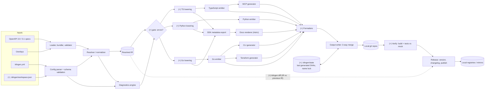
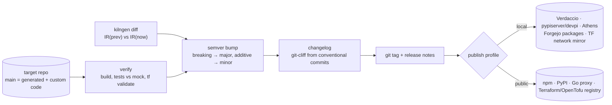
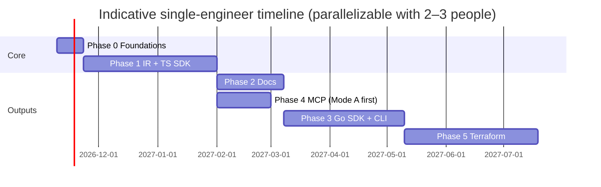

# kilngen: Project Plan for a Self-Hosted, Open-Source API Tooling Generator

> **Name:** the project is **kilngen** (command `kilngen`, config `kilngen.yml`, workspace `.kilngen/workspace.json`, spec extensions `x-kilngen-*`). The npm names `kilngen`/`@kilngen/*` and the PyPI name `kilngen` were free when the name was picked; plain "Kiln" is crowded (npm `kiln`, `kiln-cli`, PyPI `kiln`, Kiln-AI/Kiln, several MCP projects). Run a trademark search (USPTO, EUIPO) before a public launch.
> **Goal:** One local binary that turns an OpenAPI spec plus a config file into idiomatic SDKs, a docs site, a CLI, an MCP server, and a Terraform provider, with **no cloud dependency**.
> **Research basis:** The public Stainless docs (overview, config reference, workspace schema, MCP, CLI, Terraform, Docs Platform, custom code, pagination) and the Apache-2.0 source of `stainless-api/stainless-api-cli` (`stl`), as of 2026-10. This plan uses those docs only to understand the *feature set*. Everything below is an independent design (see §6).

---

## 0. TL;DR: The decisions that matter most

| # | Decision | Recommendation |
|---|---|---|
| 1 | Generator language | **TypeScript (Node 22 LTS)** monorepo, shipped as a single executable (Bun `--compile` or Node SEA). Docker image as an alternative. |
| 2 | Core abstraction | A **typed Intermediate Representation (IR)** between "OpenAPI + config" and every emitter. All five feature areas read from the IR, never from raw OpenAPI. |
| 3 | Templating | **Code-as-templates** (TypeScript emitter functions plus an indentation-aware code writer), not Mustache/Handlebars. Use static template files only for scaffolding (LICENSE, CI, `.gitignore`). |
| 4 | First SDK target | **TypeScript SDK**. The MCP server and docs snippets build on it. |
| 5 | Second SDK target | **Go SDK**. The CLI and the Terraform provider both wrap it, so it is on the critical path for Phases 3 and 5. |
| 6 | Custom-code preservation | A Git **generated-branch plus 3-way merge** workflow, run locally with plain `git`. |
| 7 | License | **MIT** for the generator (repo owner's choice; Apache-2.0 was the original recommendation, see §6.4). Put the runtime code that gets copied into generated output under **MIT-0** with an explicit "output is yours" clause. |
| 8a | Workspace file | `.kilngen/workspace.json` says *where* things live (spec paths, config path, target repos). `kilngen.yml` says *what* to generate. Per-developer overrides go in a gitignored `.kilngen/local.json`. Tool state goes in `.kilngen/state/` (§2.8). |
| 8b | Tool CLI | `kilngen` mirrors the `stl` command set (init, workspace, lint, dev, build, diff, mcp), but every command runs **locally** against the engine. `stl` is a thin client for a hosted build API (§2.9). |
| 8 | Config file | `kilngen.yml`, with a published JSON Schema and an independently designed schema. Never name it `stainless.yml`. You may add an optional *importer* later (see §6). |

---

## 1. Scope & Feature Breakdown

### 1.0 The shared foundation (needed by every feature)

The SDK generator is not one of the five areas you listed, but **all five depend on it**. Stainless's CLI wraps its Go SDK, its MCP server is a sub-package of its TS SDK, its Terraform provider builds on its Go SDK, and its docs render "SDK metadata". Plan for this foundation explicitly:

| Capability | What to implement |
|---|---|
| Spec ingestion | Read OpenAPI 3.0/3.1 (and optionally Swagger 2.0 via conversion) from YAML/JSON. Resolve external `$ref`s and bundle. Support multiple specs merged into one. |
| Normalization | Canonicalize 3.0 vs 3.1 differences (`nullable` vs `type: [x, "null"]`, `exclusiveMinimum`, `example` vs `examples`). Flatten `allOf`. Classify `oneOf`/`anyOf` as discriminated or undiscriminated unions. |
| Resource mapping | Config maps `resource → methods → "verb /path"` and `models → #/components/schemas/X`. Inference provides a default mapping when config is absent. |
| Naming | Deterministic naming of inline schemas (`AccountCreateParams`, `AccountListResponse`). Per-language casing and reserved-word escaping. Stability across regenerations. |
| Client runtime | Auth from security schemes plus env vars, retries with backoff and `Retry-After`, timeouts, idempotency keys, typed HTTP errors, pagination iterators, SSE streaming, multipart uploads, raw-response access, environments/base URL, per-request options. |
| Diagnostics | A linter over spec and config with stable codes (e.g., `K1001 UnnamedInlineSchema`), severities, and JSON-pointer locations. |
| Custom code | Users edit generated repos and those edits survive regeneration. |
| Tests | Generated unit tests per method, run against a local mock server (Prism, or a built-in mock driven by the IR). |

### 1.1 Docs platform

**What it does:** Generates an API/SDK reference site from the same IR as the SDKs, and lets you author guides alongside it in a docs-as-code Git repo you own.

| Core capability | MVP? | What to implement |
|---|---|---|
| API reference per language (signatures, params, return types, type definitions) with a language switcher | MVP | Emit `sdk-metadata.json` per target from the lowered IR. An Astro integration renders resource, method, and model pages. |
| HTTP reference with `curl` snippets | MVP | A snippet generator from the IR (curl, plus TS/Go/Python examples). |
| Guides in MDX/Markdoc with a component library (tabs, cards, asides) | MVP | Use Starlight's components. Add `<MethodRef>`, `<ModelRef>`, and `<CodeSample lang>` components that link into the reference. |
| Local dev with hot reload that watches the spec and config | MVP | `kilngen docs dev` runs a chokidar watcher that regenerates IR and metadata and triggers Astro HMR. |
| Static build, self-hostable anywhere | MVP | `astro build` produces static HTML you can deploy to nginx, Caddy, S3-compatible storage, or GitHub Pages. |
| Search (structural, faceted by language/resource/method/type) | v1 | Build the index from **IR metadata, not scraped HTML**. Pagefind covers prose; MiniSearch/Orama covers structured facets. |
| LLM-friendly Markdown per page (`/page.md`) plus `llms.txt` | v1 | Emit a `.md` twin for every page at build time. The MCP docs-search tool reuses these files. |
| AI answers (RAG) | Later, optional | Local embeddings and an LLM via an **Ollama/OpenAI-compatible endpoint the user configures**. Off by default so nothing touches the cloud. |
| Theming and full ownership | MVP | The generated site is a normal Astro project in its own repo. The reference pages come from a versioned npm package (`@kilngen/docs-astro`) so users can upgrade it without losing customizations. |

### 1.2 MCP support

**What it does:** Generates a Model Context Protocol server, so LLM clients (Claude Desktop, Cursor, VS Code, Claude Code, and others) can call your API.

| Core capability | MVP? | What to implement |
|---|---|---|
| Generated MCP server package (TS, stdio transport) | MVP | `packages/mcp-server` inside the TS SDK output, using `@modelcontextprotocol/sdk`. |
| **Mode A: one tool per endpoint** | MVP | Build tool input schemas from the IR, with filtering by resource, operation type (read/write), and tags. Simple, and works with every client. |
| **Mode B: code-execution tool plus docs-search tool** | v1 | The LLM submits TS code that runs against the generated SDK in a **Deno subprocess** with `--allow-net=<api-host>`, `--allow-env=<named vars>`, `--allow-read=<install dir>`, no write, and no subprocesses. This is more token-efficient for large APIs. |
| Docs-search tool | v1 | Serve **locally**: the build embeds the generated `.md` docs into the package and searches them with MiniSearch at runtime. This replaces any hosted docs API. |
| Client compatibility profiles | v1 | Some clients reject `$ref`, `anyOf`, or deeply nested schemas. Add a `--client=claude\|cursor\|openai-agents\|generic` flag that inlines and simplifies schemas. |
| Remote transport (Streamable HTTP) plus auth | v1 | Header-based API key passthrough first, OAuth 2.1 (per the MCP auth spec) later. Generate a Dockerfile. |
| Packaging | v1 | Publish as an npm package (`npx -y my-api-mcp`), a Docker image, and an **MCPB bundle** for one-click desktop install. Generate install snippets and deeplinks into the README. |
| Safety | MVP | Read-only mode, allow/deny lists, a confirmation hint (`destructiveHint`) on mutating tools, and a response size cap with `jq`-style filtering (`--jq` arg on tools). |

### 1.3 CLI generation

**What it does:** Generates a production-ready command-line tool for your API: `my-tool <resource> [<sub-resource>…] <method> --flag value`.

| Core capability | MVP? | What to implement |
|---|---|---|
| Command tree from resources and methods, in kebab-case | MVP | Go CLI on **urfave/cli v3** or **cobra**, wrapping the generated Go SDK. |
| Flags from params. Nested objects use dotted flags (`--name.full-name`). | MVP | Lower IR params to flags. For nested or union-heavy bodies, fall back to JSON/YAML. |
| Body from stdin or file (JSON/YAML). `@file` for uploads, `\@` to escape. | MVP | Merge order: stdin body, then flags (flags win). |
| Auth from env vars and config profiles | MVP | Reuse `client.options` from config (e.g., `read_env: MY_API_KEY`). Add `~/.config/<tool>/config.yaml` profiles. |
| Output formats: `json`, `jsonl`, `yaml`, `pretty`, `raw`. Plus `--transform` (GJSON path). | MVP | `tidwall/gjson`, plus `alecthomas/chroma` for highlighting when stdout is a TTY. |
| Auto-pagination (`--max-items`, streaming JSONL) | v1 | Use the Go SDK's iterators. |
| Shell completion, man pages, `--help` from descriptions | v1 | urfave/cli or cobra built-ins. Use `cpuguy83/go-md2man` for man pages. |
| Interactive TUI explorer | Later | `charmbracelet/bubbletea` plus `bubbles` (table/list), browsing paginated JSON. |
| Distribution | v1 | Generate a **GoReleaser** config (Homebrew tap, Scoop, deb/rpm, checksums) and a GitHub Actions workflow in the *user's* repo. |

### 1.4 Terraform provider generation

**What it does:** Generates a HashiCorp-style Terraform/OpenTofu provider so users can manage CRUD-like API resources as infrastructure-as-code.

| Core capability | MVP? | What to implement |
|---|---|---|
| Resource inference from CRUD methods (`create`/`retrieve`/`update`/`delete`/`list`) | MVP | Map IR resource methods to the `Create`/`Read`/`Update`/`Delete`/`ImportState` functions on `terraform-plugin-framework`. |
| Attribute classification | MVP | `required` comes from create-required. `optional` comes from create/update optional. `computed` comes from `readOnly` or response-only fields. `optional+computed` covers server defaults. `sensitive` comes from `writeOnly`, `format: password`, or config. Add `UseStateForUnknown` plan modifiers for IDs and timestamps. |
| Data sources (single plus list/filter) | MVP | `retrieve` maps to `data "x"`. `list` with query params maps to `data "xs"`. |
| Per-resource config: enable/disable, rename, resource vs data source, ID attribute, PUT vs PATCH | MVP | `terraform:` block on resources in `kilngen.yml` (see §4). |
| Import support | MVP | Use `ImportStatePassthroughID`, plus composite IDs (`parent_id/child_id`) for sub-resources. |
| Nested objects, lists, maps, sets | v1 | Use framework nested attributes. Use `jsontypes.Normalized` for free-form JSON. |
| Unions (`oneOf`) | v1 | Model as mutually exclusive nested blocks with `ExactlyOneOf` validators. This is the hardest mapping. |
| Docs | MVP | Run **tfplugindocs** with examples generated per resource. |
| Acceptance-test scaffold | v1 | `terraform-plugin-testing` tests per resource, gated on `TF_ACC` and an env-configured sandbox. |
| State upgraders / migrations | v1 | Generate `SchemaVersion` and `UpgradeState` stubs on breaking-change detection. The user fills them in through custom code. |
| Async operations / polling | Later | Config hook: `poll: { endpoint, until: status == "ready" }`. |
| Registry publishing | v1 | GoReleaser plus GPG signing workflow, and a `terraform-registry-manifest.json`. Works for both the Terraform and OpenTofu registries. |

### 1.5 The config file (`kilngen.yml`)

**What it does:** It is the single source of truth for *how* the spec becomes outputs. It covers API organization (resources, methods, models), client behavior (auth, retries, environments, pagination, streaming), per-target package metadata and options, and spec patches.

| Core capability | MVP? | What to implement |
|---|---|---|
| Versioned schema with **editions** (opt-in breaking codegen changes) | MVP | `version: 1` for the file format, plus `edition: 2026-11` to pin generator behavior. |
| Resources/methods/models mapping, nested sub-resources, client-level methods | MVP | Core of the IR builder. |
| Targets with package metadata, output path, per-target options, skip lists | MVP | One entry per emitter. |
| Client settings: auth options, env vars, retries, timeouts, idempotency header, default headers | MVP | |
| Environments (named base URLs; the first one is the default) | MVP | |
| Pagination schemes (cursor, cursor-from-item-id, next-URL, offset, page-number) | MVP | Declarative request/response field mapping, matched against methods automatically. |
| Streaming (SSE) config | v1 | |
| Spec transforms/patches (rename, remove, override schemas, inject `x-` extensions) | v1 | Prefer **OpenAPI Overlay 1.0** documents (a public standard) referenced from config, over a bespoke DSL. |
| Diagnostics config (suppress/upgrade rules) | MVP | |
| JSON Schema plus editor autocompletion | MVP | Publish the schema and add `# yaml-language-server: $schema=...` to scaffolds. |
| Inference: `kilngen init` drafts a config from the spec | MVP | Uses tags, path prefixes, and CRUD verb patterns. |

---

## 2. Architecture Proposal

### 2.1 Principles

1. **Local-first:** One binary with no telemetry by default and no network calls except ones the user opts into (registry publishing, an optional LLM endpoint).
2. **IR-centric:** Parsing and validation happen once. Emitters are pure functions of `(LoweredIR, TargetConfig) → VirtualFileTree`.
3. **Deterministic output:** The same inputs always produce byte-identical outputs, with stable ordering and no timestamps. This is a prerequisite for clean 3-way merges.
4. **Output is a normal repo:** Generated SDK/CLI/TF/docs repos build with standard toolchains and have zero runtime dependency on kilngen.
5. **Toolchain isolation:** Formatters and compilers (gofmt, ruff, prettier, terraform fmt) run on the host or in pinned containers (`--toolchain=docker`).

### 2.2 Component diagram (your architecture, with suggested additions)

Your diagram has the right spine: inputs, loader/bundler, resolver/normalizer, a **Resolved IR** feeding the emitters, Go wrapped by CLI and Terraform, TS wrapped by MCP, SDK metadata feeding the Astro docs, a 3-way-merge output writer, local git repos, release, and local registries. I'd keep it as the reference architecture. Seven additions, each marked **(+)** below:

| # | Gap in the current diagram | Why it matters | Suggested change |
|---|---|---|---|
| 1 | No **workspace** input | The tool needs to know where the spec, `kilngen.yml`, and each target's output repo live (the role `.stainless/workspace.json` plays for `stl`) | Add `.kilngen/workspace.json` as a fourth input (§2.8) |
| 2 | Emitters read the IR directly | Docs snippets and SDK metadata need **per-language names** (`client.projects.members.list()` vs `client.Projects.Members.List()`) | Add a **per-target lowering** step. SDK metadata export reads the *lowered* models, not the raw IR. |
| 3 | Diagnostics is a side branch | It must **gate** the build (errors stop generation), and the config parser emits diagnostics too | Both the resolver and the config parser feed diagnostics, and diagnostics feeds a gate before the emitters |
| 4 | No formatting or verification stage | Merging unformatted output causes noisy conflicts. Releasing unverified output ships broken packages. | Add **format** before the writer and **verify** (compile, tests against mock) before release |
| 5 | Docs bypass the output writer | Docs are also a repo with user customizations | Route the docs renderer output through the same writer and 3-way merge |
| 6 | No **state** | A 3-way merge needs a *base* (the last pure-generated output), and stable naming needs memory | Add `.kilngen/state/` holding the last generated SHA per target, a name lock, and build records |
| 7 | Release has no input from API changes | Version bumps should follow API semantics, not just commit messages | `kilngen diff` (IR vs previous IR) feeds the release step's semver bump and changelog |



### 2.3 Data flow, stage by stage

```text
 spec.yaml ─┐
 overlay ───┼─► [1 Load+Bundle] ─► [2 Normalize] ─► CanonicalSpec
 kilngen.yml ──┘                                         │
            └─► [3 Parse config (Zod)] ─► Config ─────┤
                                                      ▼
                         [4 Infer + Build IR] ─► ApiIR  ──► [5 Diagnostics] ─► report.json / terminal
                                                      │
              ┌───────────────────────┬───────────────┼───────────────────────┐
              ▼                       ▼               ▼                       ▼
     [6a Lower: TS]          [6b Lower: Go]    [6c Lower: Py…]       (lowering = names, type
              │                       │                                mapping, reserved words)
     ┌────────┼──────────┐   ┌────────┼──────────┬──────────┐
     ▼        ▼          ▼   ▼        ▼          ▼          ▼
  TS SDK   MCP srv   docs-meta  Go SDK   CLI    Terraform  docs-meta
     └────────┴──────────┴───────┴────────┴──────────┴──────────┘
                                      │
                     [7 Format] ─► [8 VirtualFileTree] ─► [9 Git integrate]
                                                               │
                                     generated/<target> branch ◄┘ (pure codegen commit)
                                               │ 3-way merge
                                               ▼
                                       main/next branch (codegen + user custom code)
                                               │
                                     [10 Build + test against mock server]
```

### 2.4 The IR (most important design artifact)

Define it as TypeScript types. Version it (`irVersion`) and serialize it (`kilngen ir dump --json`) so third-party emitters can exist.

```ts
interface ApiIR {
  irVersion: 1;
  info: { title: string; version: string; description?: string };
  environments: { name: string; baseUrl: string; default: boolean }[];
  auth: AuthScheme[];                 // apiKey(header|query), bearer, basic, oauth2-client-credentials
  clientOptions: ClientOption[];      // name, type, envVar, auth role, default
  resources: Resource[];              // tree; $client = root methods
  models: Record<ModelId, Model>;     // named, shared types
  pagination: PaginationScheme[];
  errors: ErrorMapping[];             // status → error class
}
interface Method {
  id: string; name: string;           // "accounts.friends.list"
  http: { verb: HttpVerb; path: string; pathParams: Param[] };
  params: { query: Param[]; header: Param[]; body?: BodyShape };
  response: TypeRef | { stream: TypeRef } | { binary: true };
  pagination?: PaginationRef; idempotent: boolean; deprecated?: string;
  docs: { summary?: string; description?: string; examples: Example[] };
  targets: Partial<Record<TargetId, { skip?: boolean; rename?: string }>>;
  terraform?: TfMethodRole;           // create|read|update|delete|list
}
type TypeRef = Primitive | Array | Map | ObjectRef | Union | Enum | Literal | Nullable | Unknown;
```

### 2.5 Custom-code preservation (local Git workflow)

```text
            regen #1           regen #2            regen #3
generated: ──●──────────────────●───────────────────●──────►   (kilngen-only commits, never edited by humans)
              \                  \                   \
main:     ─────●───●(user)──●(user)──M───────●(user)───M──────►  (M = git merge -X patience generated)
```

- kilngen writes pure output to the `generated` branch in a worktree, commits, then runs `git merge generated` into the integration branch. Git's own 3-way merge preserves user edits.
- On conflict, kilngen leaves the merge in progress and prints which files conflicted, or writes a `kilngen-conflict/<ts>` branch. It never auto-resolves.
- It also supports a `keep_files` glob list and **designated extension points** (e.g., `src/custom/**`, `_custom.go` files) that the generator never touches. This removes most merge conflicts by design.
- Implementation: shell out to the system `git`. Avoid `isomorphic-git` for merges because its merge support is limited.

### 2.6 Local runtime surface (what the user runs)

```bash
kilngen init --spec openapi.yaml        # drafts kilngen.yml from the spec + inference
kilngen lint                            # diagnostics on spec + config
kilngen generate [--target ts,go,cli]   # full pipeline → ./out/<target> (or linked repos)
kilngen generate --watch                # incremental regen on spec/config change
kilngen docs dev | kilngen docs build      # Astro dev server / static build
kilngen mock                            # local mock server from IR (for tests & demos)
kilngen test [--target ts]              # build + run generated tests against mock
kilngen diff                            # breaking-change report vs last generation (semver hint)
kilngen ir dump --json                  # IR for debugging / third-party emitters
kilngen studio                          # (later) local web UI: config editor + live preview, localhost only
```

### 2.7 Monorepo layout

```text
kilngen/
├─ packages/
│  ├─ core/              # loader, normalizer, config (zod), inference, IR, diagnostics
│  ├─ codewriter/        # indentation-aware writer, import manager, doc-comment helpers
│  ├─ target-typescript/ # lowering + emitter + runtime/ (copied into output)
│  ├─ target-go/
│  ├─ target-python/     # (post-MVP)
│  ├─ target-mcp/        # emits packages/mcp-server into TS SDK output
│  ├─ target-cli/        # emits Go CLI
│  ├─ target-terraform/  # emits Go provider
│  ├─ docs-metadata/     # IR → sdk-metadata.json + snippets
│  ├─ docs-astro/        # Astro/Starlight integration (published to npm, used by generated docs repo)
│  ├─ mock-server/
│  ├─ git-integrator/
│  ├─ workspace/       # .kilngen/workspace.json discovery, local.json merge, state dir
│  ├─ release/         # semver from IR diff, changelog, publish profiles
│  └─ cli/               # `kilngen` binary
├─ schemas/kilngen.schema.json          # generated from zod
├─ fixtures/specs/                   # golden specs (petstore, a CRUD API, a streaming API, a big real-world spec)
├─ tests/golden/                     # snapshot of generated output per fixture × target
└─ e2e/                              # compile + run generated SDK/CLI/TF against mock
```


### 2.8 Workspace file (`.kilngen/workspace.json`)

**What `stl` does today:** I read the `stl` source (`pkg/workspace/config.go`) and the public workspace schema page. The workspace file holds four fields: `project`, `openapi_spec`, `stainless_config`, and `targets.<name>.output_path`. Paths are relative to the workspace file. Discovery walks up from the current directory looking for `.stainless/workspace.json` (or a legacy `stainless-workspace.json`). Without one, it falls back to an *implicit* workspace (an `openapi.{yml,json}` plus a `*.stainless.yml` in the same directory). `project` points to a project in their **hosted** account.

**What changes when everything is local:** There is no hosted project, so the workspace becomes the place that ties the API definition to the local repos. Keep a strict split:

| File | Committed? | Answers | Owner |
|---|---|---|---|
| `kilngen.yml` | Yes | *What* to generate: resources, client behavior, target options | API team |
| `.kilngen/workspace.json` | Yes | *Where* things live: spec paths, config path, per-target output repo and branch | Repo owner |
| `.kilngen/local.json` | No (gitignored) | Per-developer overrides: different output path, toolchain mode, registry URLs | Each developer |
| `.kilngen/state/` | Yes | Last generated commit per target (the merge base), name lock, last IR snapshot (for `kilngen diff`) | The tool |
| `.kilngen/builds/`, `.kilngen/cache/` | No | Local build history, parse cache | The tool |

Proposed schema (an independent design; field names are your choice):

```jsonc
// .kilngen/workspace.json
{
  "$schema": "https://kilngen.dev/schema/workspace.v1.json",
  "version": 1,
  "name": "acme-api",                       // local identifier only, no account
  "openapi_specs": ["../openapi/core.yaml", "../openapi/billing.yaml"],
  "config": "../kilngen.yml",
  "targets": {
    "typescript": { "output_path": "../../sdks/acme-ts",  "integration_branch": "main" },
    "go":         { "output_path": "../../sdks/acme-go",  "integration_branch": "main" },
    "cli":        { "output_path": "../../tools/acme-cli" },
    "terraform":  { "output_path": "../../infra/terraform-provider-acme" },
    "docs":       { "output_path": "../../docs/acme-docs" }
  },
  "toolchain": "host",                       // host | docker
  "release": { "profile": "local" }          // refers to a registry profile (§2.10)
}
```

Discovery rules:
1. Use `--workspace <path>` if given.
2. Otherwise walk up from the current directory to the nearest `.kilngen/workspace.json`.
3. Otherwise use an implicit workspace from `openapi.{yaml,yml,json}` plus `kilngen.yml` in the current directory.
4. Merge `.kilngen/local.json` on top.

`kilngen workspace status` prints the resolved paths and whether each target repo is clean.

### 2.9 The `kilngen` CLI, mapped from `stl`

`stl` is a **thin client for the hosted Stainless API**. `stl builds create` / `stl dev` send the spec and config to their servers, poll the build, then pull each target via a temporary git token or a download URL (`builds:target-outputs`). `stl lint` asks the API for diagnostics. `stl mcp` just runs `npx @stainless-api/mcp`. **The repository contains no code generator.** It is a good *UX reference*, but the engine is entirely yours to build. In `kilngen`, every command runs locally against the engine library:

| `stl` command (hosted) | `kilngen` equivalent (local) | Notes |
|---|---|---|
| `auth login/logout/status` | none (optional `kilngen registry login <profile>`) | No account. Publish credentials go in the OS keychain (`zalando/go-keyring` or `keytar`). |
| `workspace init / status` | `kilngen workspace init / status` | §2.8 |
| `init` (creates hosted project, downloads config/targets) | `kilngen init [--spec] [--targets ts,go]` | Runs inference to draft `kilngen.yml`, writes the workspace, and `git init`s the target repos. |
| `lint [--watch]` | `kilngen lint [--watch] [--format json\|sarif]` | Local diagnostics. SARIF lets CI and editors show annotations. |
| `builds create / get / list` | `kilngen build [--target …]`, `kilngen builds list/show <id>` | Build record in `.kilngen/builds/<id>.json`: input hashes, diagnostics, per-target commit SHAs, verify results. |
| `builds compare` / `dev --base <ref>` | `kilngen diff --base <git-ref>` | Diffs the IR at two git refs of the spec repo and reports added, removed, and breaking changes per target. |
| `dev` / `preview --watch` (interactive TUI) | `kilngen dev` | Watches spec, config, and workspace. Regenerates incrementally, runs verify, and shows a live TUI. |
| `builds:diagnostics list` | `kilngen builds diagnostics <id>` | |
| `builds:target-outputs retrieve` (git token/URL) | not needed; `kilngen export --target ts --tar` for air-gapped handoff | Output is written straight to local repos. |
| `projects:branches create/rebase/reset` | git branches of the spec repo | Generating on spec branch `feat-x` writes `kilngen/generated/feat-x` plus a matching branch in every target repo. |
| `projects:configs guess` | `kilngen config infer [--merge]` | |
| `projects generate-commit-message` | `kilngen commit-msg` | Deterministic, from the IR diff, e.g. `feat(api): add projects.archive`. No LLM needed. |
| `mcp` | `kilngen mcp` | An MCP server for *the tool itself*: lint, build, explain a diagnostic, query the IR. Agents can drive generation locally. |
| `skills` (ships a Claude skill) | `kilngen skills install` | Ship a SKILL.md / AGENTS.md describing `kilngen` for coding agents. |
| `@manpages`, `@completion` | same | urfave/cli or cobra built-ins, or Node equivalents (see note below). |
| (Stainless Language Server reads the workspace) | `kilngen lsp` (Phase 6) | Completion and diagnostics in `kilngen.yml`, plus go-to-definition from `get /path` and `#/components/schemas/X` into the spec. |

Your own CLI target (§1.3) can use the same global flag conventions as `stl`: `--format auto|explore|json|jsonl|pretty|raw|yaml`, `--transform` (GJSON), and `@file` / `@file://` / `@data://` file arguments. The `explore` format is their TUI explorer. These conventions are user-facing behavior, not code, and they work well for both tools.

**Implementation language for the `kilngen` binary:** Keep it in the same language as the engine (TypeScript, §3), so the CLI calls the engine in-process. Splitting into a Go front-end plus a TS engine adds IPC and two runtimes for no user benefit. If you choose a Go engine instead, a Go CLI on urfave/cli v3 (the framework `stl` uses) is the natural fit.

### 2.10 Release, versioning, and local registries



| Artifact | Local/self-hosted registry option | Public registry |
|---|---|---|
| TS SDK, MCP server (npm) | **Verdaccio**, or the **Forgejo/Gitea** package registry (npm) | npm |
| Python SDK | **pypiserver** or **devpi**, or Forgejo (PyPI) | PyPI |
| Go SDK, CLI module | **Athens** (Go module proxy), or plain git tags plus `GOPRIVATE` | proxy.golang.org (via tags) |
| CLI binaries | Forgejo/Gitea releases, local Homebrew tap repo, or a deb/rpm repo (`aptly`) | GitHub Releases, Homebrew, Scoop |
| Terraform provider | Static **provider network mirror** (any HTTP file server), `filesystem_mirror` in the CLI config, or a self-hosted registry (e.g., **terrareg**) | Terraform and OpenTofu registries (GPG-signed) |
| MCP server image | Local OCI registry (`registry:2`, Harbor, Zot) | GHCR or Docker Hub |
| Docs site | Any static host (nginx, Caddy, MinIO) | GitHub Pages, Cloudflare Pages |

A release **profile** in the workspace (or `local.json`) selects registry URLs per artifact type. A profile like `release: { profile: local }` sends everything to the self-hosted stack. `kilngen release --dry-run` prints exactly what would be published where. Generated repos also get CI workflows (GitHub Actions or Forgejo Actions) that run the same `kilngen release` steps, so local and CI releases match.

---

## 3. Technology Stack

### 3.1 Per-component choices

| Component | Choice | Why |
|---|---|---|
| Generator runtime | **TypeScript on Node 22 LTS**. Distribute via Bun `--compile` or Node SEA, plus a Docker image. | Has the strongest OpenAPI tooling ecosystem. The docs (Astro) and MCP (official TS SDK) are also TS, and it is easy to hire for. A single-file binary keeps installs local and dependency-free. |
| Spec parsing/bundling | `@redocly/openapi-core` (bundle/lint) or `@scalar/openapi-parser`. `yaml` (eemeli) preserves source positions. | Mature, MIT-licensed. Source maps let diagnostics point to `file:line`. |
| Config schema | **Zod**, plus `zod-to-json-schema` to emit `kilngen.schema.json` | One source for runtime validation, TS types, and editor autocompletion. |
| Overlays | OpenAPI Overlay 1.0, using your own small implementation or `@redocly` support | Public standard. Avoids inventing a patch DSL. |
| Code emission | A custom `CodeWriter` (indentation, imports, doc comments) plus per-language emitters | Explicit, type-checked, and testable. Avoids the logic-in-Mustache problem that openapi-generator has. |
| Formatting | prettier (TS), gofmt/goimports (Go), ruff format (Py), `terraform fmt` | Canonical formatters, run as subprocesses. Use pinned Docker images when the host lacks them. |
| Mock server | `@stoplight/prism-cli` (Apache-2.0) at first. A native IR-driven mock later. | Fast start. A native mock gives better pagination and streaming fidelity. |
| Generated TS SDK runtime | Zero runtime dependencies: native `fetch`, `AbortController`, `ReadableStream` for SSE | Small, works on Node, Deno, Bun, and edge runtimes. |
| Generated Go SDK runtime | stdlib `net/http` plus hand-written option/param helpers, and `iter.Seq2` (Go 1.23+) for pagination | Idiomatic, no dependencies. |
| Docs site | **Astro + Starlight**, MDX/Markdoc, Shiki highlighting, **Pagefind** (prose search), **MiniSearch** or **Orama** (faceted SDK search) | Static output that is fast and self-hostable. All MIT. |
| Optional AI answers | OpenAI-compatible HTTP client pointed at **Ollama** or llama.cpp, with local embeddings stored in SQLite (`sqlite-vec`) | Keeps the "no cloud" promise because the user brings their own local model. |
| MCP server | `@modelcontextprotocol/sdk` (official), **Deno** sandbox for code mode, `@anthropic-ai/mcpb` tooling for bundles | Official SDK tracks spec changes. Deno's permission flags provide a real sandbox. |
| CLI (generated) | Go with **urfave/cli v3** or **cobra**, `tidwall/gjson`, `goccy/go-yaml`, `alecthomas/chroma`, `charmbracelet/bubbletea`, **GoReleaser** | Produces static binaries that are easy to distribute. Reuses the Go SDK. |
| Terraform (generated) | Go with **hashicorp/terraform-plugin-framework**, `terraform-plugin-testing`, `tfplugindocs`, GoReleaser + GPG | Framework is the recommended path over SDKv2. Works for OpenTofu too. |
| Monorepo tooling | **pnpm workspaces + Turborepo**, Vitest, Changesets | Standard, fast, simple releases. |
| Golden testing | Vitest snapshot of output trees, plus e2e that **compiles** outputs (`tsc`, `go build`, `go vet`, `terraform validate`) | Catches regressions in every emitter on every PR. |
| kilngen's own CI | GitHub Actions (or Forgejo/Gitea Actions for fully self-hosted users) | |

### 3.2 Single-language monorepo vs polyglot

| | **Single-language generator (TS), polyglot output** (recommended) | **Polyglot generator** (e.g., Go core, emitters in each target language) | **Go core, single language** |
|---|---|---|---|
| IR sharing | Native types, zero serialization | IR must be serialized (JSON/protobuf) and versioned across languages | Native |
| Emitter authoring | One language and one test framework. Contributors need to *read* the target language, not write the generator in it. | Emitter authors work in their native language, which helps idiomatic output | One language |
| Distribution | Bun/Node SEA binary (~50–90 MB) or Docker | Multiple runtimes required: poor local UX | Tiny static binary, best local UX |
| Docs/MCP integration | Same language as Astro and the MCP SDK | Cross-language glue | Docs and MCP are still TS, so the codebase ends up polyglot anyway |
| Ecosystem for OpenAPI | Excellent | Mixed | Good (`pb33f/libopenapi`, `kin-openapi`) |
| Build/CI complexity | Low | High | Low |

**Recommendation:** Write the generator in TS, and keep the IR serializable (`kilngen ir dump`) so you can add out-of-process emitters later (a "plugin protocol": IR JSON on stdin, file tree on stdout). If a tiny binary becomes the top priority, the Go core is the credible alternative. It is still polyglot in practice, because the docs (Astro) and the MCP output are TS.

---

## 4. `kilngen.yml` Specification (proposal)

### 4.1 Top-level schema

| Key | Type | Purpose |
|---|---|---|
| `version` | `1` | Config file format version (breaking schema changes only). |
| `edition` | `YYYY-MM` | Pins generator *behavior*. New editions opt in to breaking codegen improvements. Targets may override it. |
| `project` | `{ name, display_name, license, homepage, support_email }` | Metadata used in READMEs, package manifests, and docs. |
| `spec` | `{ path \| paths[], overlays[] }` | Input specs and Overlay 1.0 documents, applied in order. |
| `environments` | `map<name, url>` | Named base URLs. The first one is the default. |
| `client` | `{ options, retries, timeout, idempotency, headers }` | Client constructor options and behavior. |
| `auth` | `{ schemes: map, default: [] }` | Overrides or extends the spec's `securitySchemes` and `security`. |
| `pagination` | `PaginationScheme[]` | Named schemes, auto-matched against list methods. |
| `streaming` | `{ sse: {...} }` | SSE event, termination, and error conventions. |
| `errors` | `map<status\|range, ErrorName>` | Typed error classes. |
| `resources` | `map<name, Resource>` | API organization. `$client` holds root methods. `$shared` holds models only. |
| `targets` | `map<TargetId, Target>` | `typescript`, `go`, `python`, `mcp`, `cli`, `terraform`, `docs`. |
| `codegen` | `{ output_dir, git: {...}, keep_files[], formatters }` | Pipeline and Git integration. |
| `diagnostics` | `{ ignore[], error[], warn[] }` | Rule severity overrides by code. |

### 4.2 Resource schema

| Key | Type | Purpose |
|---|---|---|
| `description` | string | Docs override. |
| `models` | `map<name, "#/components/schemas/X">` | Named types exposed under this resource. |
| `methods` | `map<name, "verb /path" \| MethodConfig>` | Method mapping (shorthand or long form). |
| `subresources` | `map<name, Resource>` | Nesting, e.g. `client.accounts.members.list()`. |
| `skip` | `bool \| TargetId[]` | Skip everywhere or for specific targets. |
| `terraform` | `bool \| TerraformResourceConfig` | Opt in, rename, choose resource or data source, set ID attribute. |
| `mcp` | `bool \| { tools: include/exclude, read_only }` | MCP exposure. |
| `cli` | `bool \| { name, hidden }` | CLI exposure. |

`MethodConfig`: `{ endpoint, paginated?, pagination?, stream?, unwrap?, idempotent?, deprecated?, positional_params?, body_param_name?, skip?, docs?: { summary, examples } }`.

### 4.3 Full example

```yaml
# yaml-language-server: $schema=https://kilngen.dev/schema/v1/kilngen.schema.json
version: 1
edition: 2026-11

project:
  name: acme
  display_name: Acme
  license: Apache-2.0
  homepage: https://acme.example.com
  support_email: devrel@acme.example.com

spec:
  paths:
    - ./openapi/core.yaml
    - ./openapi/billing.yaml          # merged; conflicting component names are a diagnostic
  overlays:
    - ./openapi/overlays/sdk-fixes.yaml   # OpenAPI Overlay 1.0

environments:
  production: https://api.acme.example.com/v1
  sandbox: https://sandbox.acme.example.com/v1

auth:
  default: [bearer]                    # overrides top-level `security`
  schemes:
    bearer: { type: http, scheme: bearer }

client:
  options:
    api_key:
      type: string
      env: ACME_API_KEY
      required: true
      auth: { scheme: bearer }         # value becomes the bearer token
    org_id:
      type: string
      env: ACME_ORG_ID
      header: Acme-Org-Id              # sent on every request when set
  retries: { max: 2, backoff: exponential, initial_ms: 500, max_ms: 8000, retry_on: [408, 409, 429, "5xx"] }
  timeout_ms: 60000
  idempotency: { header: Idempotency-Key, methods: [post, patch] }
  headers:
    Acme-Api-Version: "2026-10-01"

errors:
  400: BadRequestError
  401: AuthenticationError
  403: PermissionDeniedError
  404: NotFoundError
  409: ConflictError
  422: ValidationError
  429: RateLimitError
  "5xx": InternalServerError

pagination:
  - name: cursor_page
    type: cursor                       # cursor | cursor_from_item | next_url | offset | page_number
    request:
      cursor: { param: starting_after, in: query }
      limit:  { param: limit, in: query }
    response:
      items: data
      next_cursor: { from_last_item: id }
      has_more: has_more
  - name: offset_page
    type: offset
    request:  { offset: { param: offset }, limit: { param: limit } }
    response: { items: results, total: total_count }

streaming:
  sse:
    content_type: text/event-stream
    done_sentinel: "[DONE]"
    error_event: error

resources:
  $client:
    methods:
      health: get /health

  $shared:
    models:
      error_object: "#/components/schemas/Error"
      address: "#/components/schemas/Address"

  projects:
    models:
      project: "#/components/schemas/Project"
    methods:
      create:   post   /projects
      retrieve: get    /projects/{project_id}
      update:   patch  /projects/{project_id}
      list:     { endpoint: get /projects, pagination: cursor_page }
      delete:   delete /projects/{project_id}
      archive:
        endpoint: post /projects/{project_id}/archive
        skip: [terraform]
    terraform:
      resource: true
      data_source: true
      name: project                    # → acme_project / data.acme_project / data.acme_projects
      id_attribute: id
      update_strategy: patch           # patch | put
      sensitive: [webhook_secret]
    mcp:
      read_only: false
    subresources:
      members:
        models:
          member: "#/components/schemas/ProjectMember"
        methods:
          list:   { endpoint: get /projects/{project_id}/members, pagination: offset_page }
          add:    post   /projects/{project_id}/members
          remove: delete /projects/{project_id}/members/{user_id}
        terraform:
          name: project_member
          import_id: "{project_id}/{user_id}"

  completions:
    methods:
      create:
        endpoint: post /completions
        stream: { when_param: stream, event_type: "#/components/schemas/CompletionChunk" }
    terraform: false
    cli: { name: complete }

  files:
    methods:
      upload:   post /files              # multipart detected from requestBody
      content:  { endpoint: get /files/{file_id}/content, response: binary }
    terraform: false

targets:
  typescript:
    package: "@acme/sdk"
    output: ./out/acme-ts               # or a git repo path
    runtime: { min_node: "20" }
    options:
      default_export: Acme
      emit_tests: true

  mcp:                                   # emitted into the TS SDK as packages/mcp-server
    package: "@acme/mcp"
    tool_mode: endpoints                 # endpoints | code (code = code-exec + docs-search)
    transports: [stdio, streamable_http]
    client_profiles: [claude, cursor, generic]
    code_execution:
      runtime: deno
      allow_hosts: [api.acme.example.com, sandbox.acme.example.com]
    exclude_tools: ["*.delete"]
    bundle: { mcpb: true, docker: true }

  go:
    module: github.com/acme/acme-go
    output: ./out/acme-go
    options: { min_go: "1.23" }

  cli:
    binary: acme
    output: ./out/acme-cli
    module: github.com/acme/acme-cli
    options:
      default_format: auto               # auto | json | jsonl | yaml | pretty | raw
      tui: false
      release: { goreleaser: true, homebrew_tap: acme/homebrew-tap }

  terraform:
    provider: acme                       # repo/module must be terraform-provider-acme
    module: github.com/acme/terraform-provider-acme
    output: ./out/terraform-provider-acme
    options:
      infer_resources: true              # auto-enable CRUD-shaped resources
      registry: [terraform, opentofu]

  docs:
    output: ./out/acme-docs
    framework: astro-starlight
    languages: [http, typescript, go, cli]
    guides_dir: ./docs/guides
    search: { prose: pagefind, reference: minisearch }
    llm: { markdown_twins: true, llms_txt: true, answers: { enabled: false, endpoint: "http://localhost:11434/v1", model: "llama3.1" } }

codegen:
  git:
    enabled: true
    generated_branch: kilngen/generated
    integration_branch: main
    on_conflict: stop                    # stop | branch
  keep_files:
    - .github/workflows/custom-*.yml
    - src/custom/**
  formatters: { mode: host }             # host | docker

diagnostics:
  ignore: [K2004]                        # e.g. "method missing description"
  error:  [K1001]                        # treat unnamed inline schemas as errors
```

### 4.4 OpenAPI vendor extensions (escape hatch inside the spec)

`x-kilngen-name`, `x-kilngen-skip`, `x-kilngen-pagination-items`, `x-kilngen-terraform: { computed: true, sensitive: true }`, `x-kilngen-cli: { positional: true }`. Config always overrides extensions. Overlays can inject extensions without editing the source spec.

---

## 5. MVP Roadmap

Complexity uses S/M/L/XL. Estimates are **person-weeks for one senior engineer** at production quality (golden tests plus compile checks). A small team can run phases in parallel after Phase 1.

| Phase | Theme | Est. | Complexity |
|---|---|---|---|
| 0 | Foundations and Scaffolding | 1–2 wk | S |
| 1 | OpenAPI → IR + TypeScript SDK | 8–12 wk | XL |
| 2 | Docs site | 4–6 wk | L |
| 3 | Go SDK + CLI | 7–10 wk | L/XL |
| 4 | MCP server | 3–5 wk | M |
| 5 | Terraform provider | 8–12 wk | XL |
| 6 | Hardening and ecosystem | ongoing | — |

**Ordering note:** Phase 4 (MCP Mode A) depends only on Phase 1, so you can **pull it ahead of Phase 2** if AI-agent demand drives adoption. It is the cheapest high-visibility deliverable.

### Phase 0: Foundations (S, 1–2 wk)
- Monorepo (pnpm + Turborepo + Vitest + Changesets) with MIT LICENSE, NOTICE, DCO, CONTRIBUTING, SECURITY.md, and a clean-room policy doc (§6).
- `kilngen` binary skeleton (`init`, `workspace init/status`, `lint`, `build`) and Zod schemas for `kilngen.yml` **and** `.kilngen/workspace.json`, both producing JSON Schemas.
- Workspace discovery (explicit file, then walk-up, then implicit) and the `.kilngen/state/` layout.
- A fixture corpus of 6–10 specs: petstore, a CRUD API, cursor/offset pagination, SSE streaming, multipart, deep unions, and a large real-world public spec such as GitHub's or Stripe's public OpenAPI.

### Phase 1: OpenAPI parsing + TypeScript SDK (XL, 8–12 wk)
| Deliverable | Notes |
|---|---|
| Loader/bundler/normalizer for OpenAPI 3.0 and 3.1 | Source-position tracking for diagnostics. |
| Config parser, inference engine, IR v1 | `kilngen init` drafts config. `kilngen ir dump`. |
| Diagnostics engine with ~30 initial rules | Unnamed inline schemas, missing operationIds, ambiguous unions, unmapped endpoints. |
| CodeWriter plus TS lowering and emitter | Client, resources, params/response types, docstrings from descriptions. |
| TS runtime | Auth/env, retries, timeouts, idempotency, typed errors, pagination iterators (`for await`), SSE, multipart, raw response, environments. |
| README generator and per-method tests against the mock server | |
| Golden plus compile tests (`tsc --noEmit`, test run) in CI | |
| `kilngen dev` watch loop and `kilngen builds list/show` build records | Develop the `dev` loop alongside the TS emitter. It is the main feedback loop. |
| Git integrator (generated branch + 3-way merge) | Ship early, because output stability bugs surface here. |

**Exit criteria:** For three fixture specs, the generated SDK compiles, its tests pass against the mock, and regeneration with a user edit preserves that edit.

### Phase 2: Docs site (L, 4–6 wk)
| Deliverable | Notes |
|---|---|
| `docs-metadata` emitter | Per-language signatures, types, and snippets (HTTP/curl + TS). |
| `@kilngen/docs-astro` Starlight integration | Resource, method, and model pages, a language switcher, and a sidebar generated from the resource tree. |
| Guide authoring with reference components | `<MethodRef id="projects.create"/>` |
| `kilngen docs dev` (watch spec/config → HMR) and `kilngen docs build` (static) | |
| Search | Pagefind for prose plus a MiniSearch index built from metadata (facets: language, kind, resource). |
| `.md` twin per page plus `llms.txt` | Reused by MCP docs-search in Phase 4. |

### Phase 3: Go SDK + CLI (L/XL, 7–10 wk)
| Deliverable | Notes |
|---|---|
| Go lowering and emitter, plus runtime | Functional options, `param.Opt[T]`-style optionals for omit vs null vs zero, iterators, SSE, typed errors. **About half the phase.** |
| CLI emitter | Command tree, kebab-case flags, dotted nested flags, stdin JSON/YAML, `@file`, env auth, `--format`, `--transform`. |
| Auto-pagination, completion, man pages | |
| GoReleaser config plus release workflow in the generated repo | |
| e2e: build the CLI and run scripted commands against the mock | |

### Phase 4: MCP server (M, 3–5 wk)
| Deliverable | Notes |
|---|---|
| Mode A: tool per endpoint, stdio | Filters, read-only mode, destructive hints, schema simplification profiles. |
| Mode B: code tool (Deno sandbox) + local docs-search tool | Uses the Phase 2 markdown twins, embedded at build time. |
| Streamable HTTP transport with header auth and a Dockerfile | OAuth 2.1 deferred to Phase 6. |
| MCPB bundle, README install snippets/deeplinks | |
| e2e with MCP Inspector (`@modelcontextprotocol/inspector`) scripted against the mock | |

### Phase 5: Terraform provider (XL, 8–12 wk)
| Deliverable | Notes |
|---|---|
| CRUD-shape analyzer | Reports *why* a resource is or isn't Terraform-eligible (diagnostic codes). |
| Schema mapping | required/optional/computed/sensitive, nested attributes, plan modifiers, `jsontypes`. |
| Resource and data-source emitters | Plural list data sources, import with composite IDs. |
| PUT vs PATCH update strategies, drift-safe Read (null vs empty handling) | Most bug reports will come from here. |
| tfplugindocs examples and docs, acceptance-test scaffold, state-upgrader stubs | |
| e2e | `terraform init/plan/apply/destroy` against the mock (and OpenTofu), plus `terraform validate` in CI. |

### Phase 6: Hardening & ecosystem (ongoing)
- Python SDK (high demand), then Java/Kotlin/Ruby/C#/PHP via community emitters that use the IR plugin protocol.
- `kilngen diff` breaking-change detection driving `kilngen release` (semver bump, git-cliff changelog, publish profiles for local registries: Verdaccio, pypiserver/devpi, Athens, Forgejo packages, TF network mirror). Pull this into Phase 1–2 if early users need local publishing.
- `kilngen mcp` (MCP server for the tool itself), `kilngen skills install`, and `kilngen lsp` (language server for `kilngen.yml` with go-to-definition into the spec).
- Optional `kilngen studio`, a local web UI (config editor, live diagnostics, output preview) bound to `127.0.0.1`.
- OAuth 2.1 for remote MCP, the CLI TUI explorer, docs AI answers via local LLM, and webhook verification helpers.
- An optional *importer* that translates other tools' config formats into `kilngen.yml` (see §6 for the legal guardrails).



---

## 6. Legal & Licensing Considerations

> This is engineering guidance, not legal advice. Have an IP lawyer review the clean-room policy and naming before your first public release.

### 6.1 Clean-room implementation
| Do | Don't |
|---|---|
| Write a **feature-level spec** (like §1 of this doc) from public, high-level descriptions of *what* the product does. Implement from that spec only. | Copy text, tables, code samples, or schema descriptions from Stainless docs into your repo, docs, or comments. |
| Design your own config key names and structure. Where you naturally converge on common concepts (resources, methods, environments), express them in your own words and shape. | Reproduce their config schema verbatim, or ship a file named `stainless.yml`. |
| Base runtime behavior on **public standards**: OpenAPI, Overlay, MCP, SSE (WHATWG), RFC 9110 retry semantics, the HashiCorp framework docs. | Decompile, deobfuscate, or reverse-engineer their CLI, Studio, or hosted services, or use the hosted product to mass-generate reference output to copy. |
| Keep a `CLEANROOM.md` and require contributors to affirm (DCO sign-off plus a PR template checkbox) that they have not copied proprietary code. | Accept contributions from current or former employees with access to proprietary source unless counsel approves a separation process. |
| Record design decisions (ADRs) with their reasoning. This documents independent creation. | Use their logos, color scheme, illustrations, or page layouts in your docs theme. |

**Generated SDKs on GitHub:** Many companies publish SDKs generated by commercial tools under permissive licenses. Studying public *behavior* (what retries, pagination, and errors look like to users) is fine. **Do not copy their code into your runtime templates.** If you ever intentionally reuse permissively licensed code, preserve its license and NOTICE and record it in `THIRD_PARTY_NOTICES`. A blanket rule of *no copying of generated output* is the simplest policy.

### 6.2 Trademarks
- Do not use "Stainless" (or confusingly similar names) in your product name, package names, domain, logo, or CLI command.
- Nominative use is generally acceptable in factual statements, e.g., "Migrating from Stainless" or "an open-source alternative to Stainless." Avoid implying endorsement and avoid "Stainless-compatible" as a badge.
- "Terraform" and "HashiCorp" are trademarks (HashiCorp is now an IBM company). Say "a provider for Terraform and OpenTofu." "MCP" is an open protocol, and its naming is fine.

### 6.3 Using `stainless-api/stainless-api-cli` (`stl`)
- **License:** Apache-2.0, copyright "Stainless". Most of its Go files carry "File generated from our OpenAPI spec by Stainless", so the repo is also the best public example of their *CLI generator's output*. There is no NOTICE file in the repo as of today.
- **What you may do:** Reading it to understand UX and behavior is fine: commands, flags, formats, `@file` semantics, workspace discovery. You may even copy or fork code into the **kilngen tool itself** if you keep the Apache-2.0 license text and copyright notice, mark changed files, and don't use their trademarks (Apache-2.0 §4 and §6).
- **What to avoid:** Copying their code into **templates that end up in users' generated output**, e.g. their `requestflag`, `apiform`, or `jsonview` packages in your CLI target. Every generated CLI would then inherit Apache-2.0 attribution obligations to Stainless, which conflicts with the "output is yours / MIT-0" promise (§6.5). It would also make the clean-room story harder to defend. Re-implement those behaviors from your own spec.
- **Practical rule:** Treat `stl` as a *behavioral reference*. Write down the behaviors you want (e.g., "dotted flags for nested params", "`--format explore` opens a TUI") in your own words in a spec doc, and implement from that doc. Don't keep their source open side by side while writing templates.

### 6.4 Config interoperability (importer)
- Reading another tool's config *format* to migrate users is a common interoperability feature. An `kilngen import stainless` could read `.stainless/workspace.json` (four documented fields) and a `stainless.yml`, and write `.kilngen/workspace.json` plus `kilngen.yml`. **Read-only:** never write `.stainless/` files, and never present kilngen as Stainless-compatible. Still, implement it from user-provided files, not from copied schema docs. Keep it in a separate, optional package (`@kilngen/import-*`) and get legal sign-off first. It is low priority (Phase 6).

### 6.5 Choosing licenses
| Artifact | Recommended license | Reason |
|---|---|---|
| kilngen generator, core, docs integration | **MIT** (chosen). Apache-2.0 was the alternative considered. | MIT is shortest and most familiar. Apache-2.0 would add an explicit patent grant and trademark clause; switching later needs contributor agreement, so decide before outside contributions arrive. |
| Runtime code and templates **copied into generated output** | **MIT-0** (or Apache-2.0 plus an explicit output exception) | Users must be able to license their generated SDKs however they like without attribution burdens. State in the README and LICENSE: *"Output generated by kilngen is owned by you; kilngen claims no copyright in it."* |
| Docs content (your own docs site) | CC BY 4.0 | Common for docs. |
| Contributions | **DCO** (Signed-off-by) rather than a CLA | Lower friction. A CLA only matters if you might relicense later. |

**Dependency licenses to watch:**
- `terraform-plugin-framework` is **MPL-2.0**. It is file-level copyleft and fine as a dependency of generated providers. Don't copy its files into templates.
- **Terraform CLI itself is BUSL-1.1** (since 2023). You only invoke it in tests, which is fine, but list **OpenTofu (MPL-2.0)** as a first-class supported runtime.
- Run `license-checker`/`pnpm licenses` and `go-licenses` in CI. Disallow GPL/AGPL/SSPL in the generator and in generated-runtime dependencies.

---

## 7. Open Risks & Questions

### 7.1 Technical risks
| Risk | Impact | Mitigation |
|---|---|---|
| **Real-world specs are messy** (missing operationIds, inline schemas, inconsistent pagination, wrong `required`) | High: most user pain lives here | Invest in inference, diagnostics, and Overlays early. Test against 3–5 large public specs from day one. |
| **Naming stability** across regenerations | High: renamed types are breaking SDK changes | Make names deterministic from config and paths, keep a `kilngen.lock` name registry, and add `kilngen diff` breaking-change detection. |
| **Union types** (`oneOf`/`anyOf`) per language, especially Go and Terraform | High | Define union lowering rules per target in the IR design doc *before* coding emitters. Emit a diagnostic for undiscriminated unions. |
| **Omit vs null vs zero** semantics (PATCH bodies, Go, Terraform) | High: subtle data bugs | Use a tri-state optional type in the Go runtime and explicit null-handling rules in Terraform. Add dedicated fixtures. |
| **3-way merge conflicts** on regeneration | Medium | Deterministic output, extension-point files, `keep_files`, and never auto-resolving conflicts. |
| **Terraform drift and perpetual diffs** (server-normalized values, defaults, ordering) | High | Plan modifiers, `optional+computed`, set vs list decisions in config, and acceptance tests against a real dev environment. Accept that TF needs per-API tuning. |
| **MCP spec churn and client fragmentation** | Medium | Pin the official SDK, use client profiles, and regenerate MCP independently of SDK versions. |
| **Code-execution sandbox security** (Deno permissions, prompt injection, secret exfiltration) | High for Mode B | Deny-by-default flags, allow-list hosts, CPU/memory/time limits, env var allow-list, and make Mode B opt-in. Have it security-reviewed. |
| **Toolchain availability locally** (go, deno, terraform, formatters) | Medium | `kilngen doctor`, a `--toolchain=docker` fallback, and a pinned devcontainer. |
| **Scope creep across 5+ targets** | High: the most common cause of failure for this kind of project | Strict phase exit criteria. Make the TS SDK excellent before going broad. |

### 7.2 Decisions to make before starting
1. **Generator language:** TS (recommended) or Go? This decides hiring, the plugin story, and binary size.
2. **First SDK target:** TS (enables MCP and docs early) or Go (enables CLI and Terraform earlier)? Your answer changes the Phase 3/4 order.
3. **Config philosophy:** Should config be mandatory, or should inference drive defaults? Recommendation: **inference by default**, with config to override, plus `kilngen init` to materialize it.
4. **Spec support:** OpenAPI 3.0 and 3.1 only, or Swagger 2.0 too (via conversion)? AsyncAPI or webhooks later?
5. **Generated code style:** Zero-dependency runtimes, or depend on a published `@kilngen/runtime` package? Recommendation: **vendored, zero-dependency** runtime, so users never depend on kilngen at runtime.
6. **Custom-code model:** Git 3-way merge only, or also explicit extension points? Recommendation: both.
7. **Output repos:** Does kilngen manage separate Git repos per target (multi-repo), or one output monorepo? This affects Git integration and release automation.
8. **Publishing:** Does kilngen only generate CI workflows that publish (stays local and cloud-free), or does it also publish directly from the CLI? Recommendation: generate workflows only.
9. **Editions/versioning policy:** How often you cut editions, and how long you support old ones.
10. **Governance:** Solo maintainer vs foundation-bound (e.g., later CNCF/OpenJS sandbox), trademark ownership of the project name, and whether a commercial hosted offering is ever planned. That last question affects license choice: Apache-2.0 still allows one, AGPL would deter competitors but also adopters.
11. **Docs hosting stance:** Static output only (recommended), or also provide a self-hosted server with search API and AI answers?
12. **Telemetry:** None (recommended for the local-first positioning), or opt-in anonymous usage stats?

### 7.3 Suggested first two weeks (concrete next actions)
1. Run a trademark search for "kilngen" and register the GitHub org and the `@kilngen` npm scope.
2. Write ADR-001 (generator language), ADR-002 (IR shape, including union and nullability rules), and ADR-003 (custom-code model).
3. Commit `CLEANROOM.md`, LICENSE (MIT), and the output-ownership statement.
4. Assemble the fixture spec corpus and write the first 10 diagnostics against it. This tells you more about the real problem than any emitter code.
5. Implement `kilngen init` plus `kilngen ir dump` end-to-end on petstore before writing any SDK emitter.
